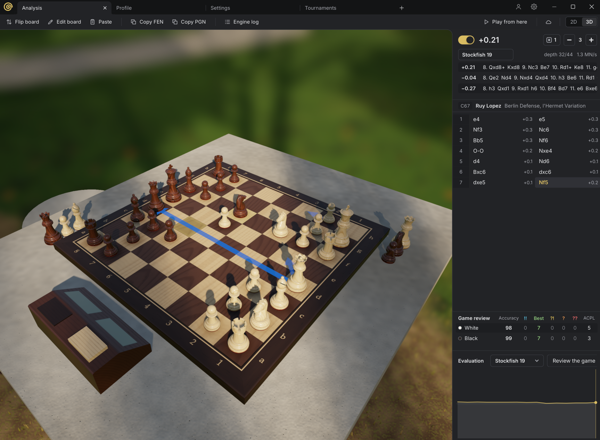
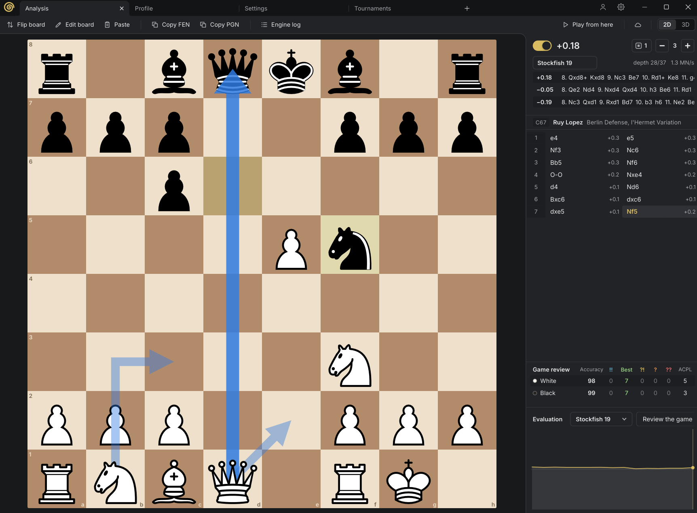

# Snail-Chess-Gui
Open source chess GUI written in Snail

## Features

- **Analyze games and positions.** Paste a PGN or FEN, or set up the board, and follow an engine's best lines as
  arrows on the board, with the opening's name and an evaluation graph. Game review scores each side's accuracy and
  marks brilliant moves, best moves, inaccuracies, mistakes and blunders.
- **Play on Lichess** against real players from your own account, in rapid and classical games, on the 2D board or
  the 3D table in any board style you like.
- **Play against chess engines** at the strength you choose, by Elo, depth or nodes, with a clock and any time
  control. Your games give you a bullet, blitz, rapid and classical rating on your profile.
- **Create engine tournaments**, round robin or gauntlet, starting from openings in your books, with draw and resign
  adjudication and live standings.
- **Test engine builds with fastchess**, in fixed-length matches or SPRT tests that stop once the result is clear.
- **Download chess engines in a few clicks** from the engine registry. Search the catalog, compare GitHub statistics
  and CCRL ratings, and install the build that suits your CPU, verified as it downloads.
- **Download opening books** from the book registry, verified against the catalog, or import Polyglot, PGN and EPD
  books.
- **Make your own opening books** with the engines you choose. The book maker generates opening lines and keeps
  those whose evaluation falls within the range you set.
- **A position database** keeps every evaluation your engines make, along with games from PGN files and Lichess.
  See what each engine said about a position, ranked by CCRL rating.
- **Cloud evaluations.** See other people's engine evaluations beside your analysis, and share your own if you like.
- **2D and 3D boards.** In 2D, 12 piece sets, some of them animated, on 19 board colours. In 3D, wood, marble, glass
  or metal pieces on a table in a library, a park, a bedroom or on Mars.
- **Effects** you can turn on: embers from captured pieces, flames on check, dust where pieces land, moss on pieces
  left standing idle, and a glow on sacrifices that turns gold when the engine confirms them. Pieces can even dress
  up for Halloween, Christmas or a party.
- **Comes with Snail Chess**, its own engine, so you can play and analyze right away.

## License

Copyright 2026 Angelo Wolff. Snail Chess GUI is free software under the GNU General Public License, version 3 or
(at your option) any later version, see LICENSE.

Bundled assets and libraries keep their own licenses:

- Classic pieces: Cburnett's, under the BSD license, see `assets/pieces/classic/LICENSE.txt`.
- Fonts: Inter, Gluten and Pixelify Sans under the SIL Open Font License 1.1, Chewy under the Apache License 2.0,
  each with its license in `assets/fonts/<name>/`.
- Opening names: Lichess's [chess-openings](https://github.com/lichess-org/chess-openings), CC0.
- The other piece sets and the sounds: CC0, see each folder's `SOURCE.txt`.
- `engines/snailchess.exe`: [Snail Chess](https://github.com/CodeAdopter/Snail-Chess), GPL-3.0.
- [Snail Db](https://github.com/CodeAdopter/Snail-Db), built into the app: MPL-2.0.
- SDL3, which the app loads as `SDL3.dll`: zlib license.
